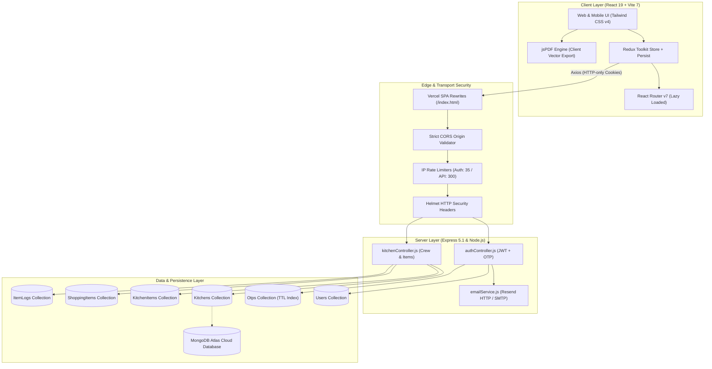
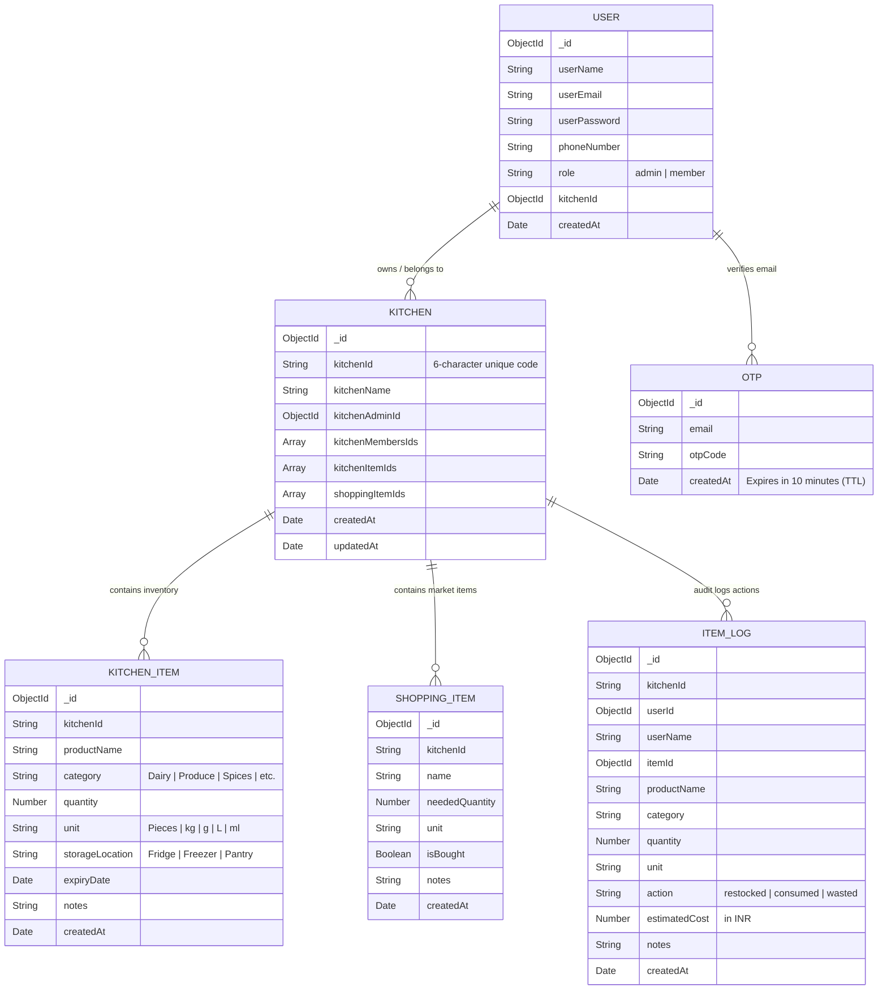
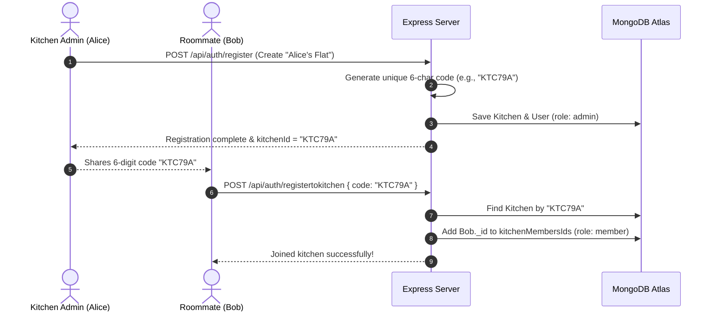
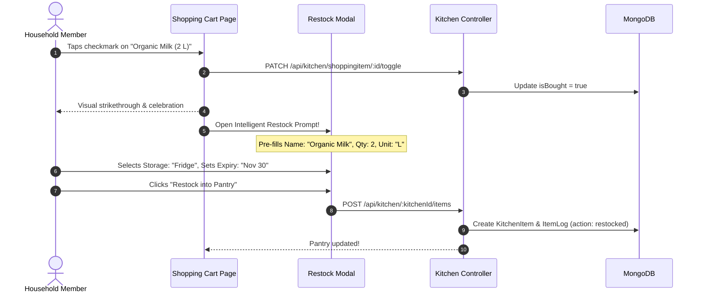
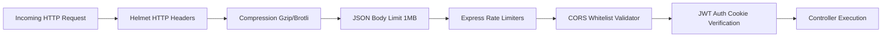

# 🍳 CookTrack MERN: Complete System Architecture, Tech Stack & Study Guide

Welcome to the comprehensive technical documentation and study guide for **CookTrack MERN**. This document breaks down the entire project from ground up—explaining every architectural decision, backend controller, database model, frontend component, deployment fix, and optimization introduced across the platform.

---

## 📑 Table of Contents
1. [Executive Summary & Problem Statement](#1-executive-summary--problem-statement)
2. [Full Technology Stack & Library Breakdown](#2-full-technology-stack--library-breakdown)
3. [System Architecture & Data Flow Diagrams](#3-system-architecture--data-flow-diagrams)
4. [Database Models & Schema Design](#4-database-models--schema-design)
5. [Deep Dive: Core Features & Implementations](#5-deep-dive-core-features--implementations)
   - [5.1 Authentication, Dual-Token JWT & The Render SMTP Workaround](#51-authentication-dual-token-jwt--the-render-smtp-workaround)
   - [5.2 Multi-Tenant Kitchen Crew & 6-Character Invite Code](#52-multi-tenant-kitchen-crew--6-character-invite-code)
   - [5.3 Pantry Inventory & Expiry Radar Algorithm](#53-pantry-inventory--expiry-radar-algorithm)
   - [5.4 Collaborative Shopping Cart & Instant Restock Pipeline](#54-collaborative-shopping-cart--instant-restock-pipeline)
   - [5.5 Client-Side PDF Generation Engine (`jspdf`)](#55-client-side-pdf-generation-engine-jspdf)
   - [5.6 Kitchen Insights, Eco-Score & Waste Tracking Engine](#56-kitchen-insights-eco-score--waste-tracking-engine)
   - [5.7 Mobile-First Responsive Ergonomics & Navigation](#57-mobile-first-responsive-ergonomics--navigation)
   - [5.8 Modern Landing Page Overhaul](#58-modern-landing-page-overhaul)
6. [Security, Performance & Deployment Hardening](#6-security-performance--deployment-hardening)
7. [API Endpoints Reference](#7-api-endpoints-reference)
8. [Local Development & Environment Variables](#8-local-development--environment-variables)

---

## 1. Executive Summary & Problem Statement

### The Problem
- **Food Spoilage & Financial Waste**: Households routinely discard up to 30–40% of fresh food simply because expiration dates are forgotten once items are stored inside refrigerators or deep pantry shelves.
- **Disorganized Grocery Trips**: Family members or roommates frequently buy duplicate items or forget essentials because shopping lists are scattered across messaging apps, paper notes, or individual memory.
- **Double Data Entry Fatigue**: In conventional apps, buying groceries requires entering items in a shopping list, checking them off, and then separately re-entering those items into a pantry tracker.

### The CookTrack Solution
CookTrack is an integrated **collaborative kitchen ecosystem** designed to bridge the pantry and the supermarket:
1. **Shared Multi-Member Kitchen**: Families and roommates join a single kitchen using a **6-character invite code**.
2. **Smart Expiry Radar**: Organizes items into storage zones (**Fridge**, **Freezer**, **Shelf**) with automated $\le 7$-day expiry countdown alerts.
3. **Continuous Shopping-to-Pantry Loop**: When an item is checked off in the shared shopping cart, an intelligent **Restock Prompt** automatically ports it to the pantry with custom quantity and expiration data.
4. **1-Click Printable PDF**: Allows members to download clean, printable grocery checklists for physical shopping trips.
5. **Zero-Waste Analytics & Eco-Score**: Tracks items marked as **Consumed** vs. **Wasted**, computes money saved in Indian Rupees (₹), and calculates a dynamic Eco-Score.

---

## 2. Full Technology Stack & Library Breakdown

### 2.1 Backend Stack (Node.js & Express)
| Technology / Package | Version | Purpose in CookTrack |
| :--- | :--- | :--- |
| **Node.js** | LTS (ES Modules) | Server runtime supporting modern `import/export` syntax. |
| **Express** | `5.1.0` | Next-generation web framework handling HTTP routing and middleware. |
| **Mongoose** | `8.20.0` | Object Data Modeling (ODM) for MongoDB Atlas with schemas and validation. |
| **jsonwebtoken** | `9.0.2` | Issues and verifies dual JWT access (15 min) and refresh (7 day) tokens. |
| **bcrypt / bcryptjs** | `6.0.0` / `3.0.3` | One-way salting and hashing for user passwords. |
| **helmet** | `8.3.0` | Secures Express apps by setting appropriate HTTP response headers. |
| **compression** | `1.8.2` | Gzip/Brotli response compression to minimize payload bandwidth. |
| **express-rate-limit** | `8.7.5` | Protects endpoints against brute-force (35 req/15m for auth, 300 req/15m for API). |
| **cookie-parser** | `1.4.7` | Parses secure, HTTP-only cookies storing session tokens. |
| **cors** | `2.8.5` | Manages Cross-Origin Resource Sharing for local and production Vercel frontends. |
| **nodemailer** | `10.2.1` | SMTP email transport for OTP delivery. |
| **Resend REST API** | HTTPS / Port 443 | Outbound email delivery bypassing cloud hosting SMTP port bans. |

### 2.2 Frontend Stack (React 19 & Vite 7)
| Technology / Package | Version | Purpose in CookTrack |
| :--- | :--- | :--- |
| **React** | `19.1.1` | Latest React with optimized rendering and concurrent features. |
| **Vite** | `7.1.7` | Blazing-fast build tool, HMR dev server, and Rollup production bundler. |
| **TypeScript** | `5.8.3` | Type-safety across all components, slices, and API response payloads. |
| **Tailwind CSS** | `4.1.13` | Utility-first styling with the new Vite compiler engine for instant CSS updates. |
| **Redux Toolkit** | `2.9.0` | Centralized state management for authentication, kitchen data, and cart. |
| **redux-persist** | `6.0.0` | Persists user credentials in local storage across browser refreshes. |
| **React Router** | `7.9.2` | Client-side routing with nested layouts, lazy route loading, and route protection. |
| **jspdf** | `4.2.1` | Client-side vector PDF generation for downloading grocery lists. |
| **Ant Design (antd)**| `5.27.4` | Enterprise UI components (drawer, desktop sidebar menu, message toasts). |
| **React Icons** | `5.5.0` | High-fidelity iconography from FontAwesome 6, Feather Icons, and Lucide. |
| **axios** | `1.13.2` | HTTP client configured with `withCredentials: true` for cookie exchange. |

---

## 3. System Architecture & Data Flow Diagrams

### 3.1 High-Level Architecture Flowchart



---

## 4. Database Models & Schema Design

CookTrack utilizes 6 interconnected Mongoose models in MongoDB Atlas:



---

## 5. Deep Dive: Core Features & Implementations

### 5.1 Authentication, Dual-Token JWT & The Render SMTP Workaround

#### The Problem: Render Free Tier Port Restrictions
When deploying to cloud platforms like **Render**, all outbound traffic on standard SMTP ports (`25`, `465`, and `587`) is blocked or throttled by default. Standard `nodemailer` attempts to establish TCP sockets to `smtp.gmail.com:465` would hang indefinitely, causing the signup request to hit gateway timeouts ($504\text{ Gateway Timeout}$) and preventing users from receiving OTP emails.

#### The Solution: Multi-Tiered Email Strategy (`server/src/config/emailService.js`)
We designed a fail-safe, 4-tier email architecture:
1. **Tier 1: Resend HTTP REST API (Port 443)**: Sends requests over standard outbound HTTPS (Port 443), which is never blocked by cloud hosts.
2. **Tier 2: Brevo (Sendinblue) HTTP REST API (Port 443)**: Alternate HTTPS REST provider.
3. **Tier 3: Fast-Timeout Nodemailer SMTP (5 seconds)**: Attempts SMTP with a strict 5-second socket timeout (`connectionTimeout: 5000`). If blocked, it fails fast rather than hanging the server.
4. **Tier 4: Cloud OTP Fallback**: If external email delivery is completely unavailable, the generated OTP is logged and safely provided in development/fallback mode so user registration is never stalled.

#### Dual-Token Session Architecture
- **Access Token**: Short-lived (15 minutes), signed with `JWT_SECRET`.
- **Refresh Token**: Long-lived (7 days), signed with `JWT_REFRESH_SECRET`.
- Stored exclusively in **HTTP-only, Secure, SameSite: None** cookies to defend against Cross-Site Scripting (XSS) attacks.

---

### 5.2 Multi-Tenant Kitchen Crew & 6-Character Invite Code



#### Dual-Credential Admin Authorization
For critical kitchen operations (e.g. deleting the kitchen, revoking member access, or transferring admin rights), CookTrack executes `verifyAdminCredentials`:
- Requires the admin's **login password** (hashed check via `bcrypt.compare`).
- Requires the admin's **registered 10-digit mobile phone number**.
- Prevents accidental deletions and unauthorized session hijacking.

---

### 5.3 Pantry Inventory & Expiry Radar Algorithm

Items in [`client/src/pages/KitchenItem.tsx`](file:///e:/projects%20dev/CookTrack%20Mern/client/src/pages/KitchenItem.tsx) are categorized into three physical storage locations:
- ❄️ **Fridge**: Perishables (dairy, fresh produce, opened sauces).
- 🧊 **Freezer**: Frozen foods, meats, batch-cooked meals.
- 🥫 **Pantry Shelf**: Dry grains, spices, canned goods, snacks.

#### Expiry Radar Classification Formula
```typescript
const calculateStockStatus = (expiryDate: string, quantity: number) => {
  if (quantity <= 0) return { label: "Out of Stock", color: "red" };
  if (!expiryDate) return { label: "In Stock", color: "green" };

  const daysUntilExpiry = Math.ceil(
    (new Date(expiryDate).getTime() - Date.now()) / (1000 * 60 * 60 * 24)
  );

  if (daysUntilExpiry < 0) return { label: "Expired", color: "rose" };
  if (daysUntilExpiry <= 7) return { label: "Expiring Soon", color: "amber" };
  if (quantity <= 2) return { label: "Low Stock", color: "yellow" };
  return { label: "In Stock", color: "emerald" };
};
```

---

### 5.4 Collaborative Shopping Cart & Instant Restock Pipeline



---

### 5.5 Client-Side PDF Generation Engine (`jspdf`)

Rather than relying on heavy server-side headless browsers (like Puppeteer), CookTrack compiles grocery lists directly on the client's device using `jspdf`:
- **Vector Quality**: Sharp typography at any zoom level.
- **Instant Generation**: Takes $< 100\text{ms}$ with zero backend server load.
- **Dynamic Pagination**: Calculates running Y-coordinates; if content exceeds page bounds ($297\text{mm}$ for A4), it automatically calls `doc.addPage()` and re-renders table headers.
- **Branded Layout**: Includes CookTrack emerald header ribbon, kitchen name, generation timestamp, summary counts (Total / To Buy / Bought), and checkbox guide.

---

### 5.6 Kitchen Insights, Eco-Score & Waste Tracking Engine

Located in [`client/src/pages/KitchenInsights.tsx`](file:///e:/projects%20dev/CookTrack%20Mern/client/src/pages/KitchenInsights.tsx) and powered by `getKitchenAnalytics`:

#### 1. Consumed vs. Wasted Logging
When an item is depleted from the pantry, members choose:
- 🍽️ **Mark as Consumed**: Food was eaten $\rightarrow$ logs money saved.
- 🗑️ **Mark as Wasted**: Food spoiled or expired $\rightarrow$ logs financial loss.

#### 2. Eco-Score Calculation Formula
$$\text{Consumed Ratio} = \frac{\text{Total Consumed Items}}{\text{Total Consumed} + \text{Total Wasted}}$$
$$\text{Eco-Score} = \text{clamp}\Big(\text{round}\big(\text{Consumed Ratio} \times 100\big), 0, 100\Big)$$

- **Eco-Score $\ge 85$**: *"Eco Champion"* (Leaf green)
- **Eco-Score $70 - 84$**: *"Good Kitchen"* (Emerald)
- **Eco-Score $50 - 69$**: *"Moderate Waste"* (Amber)
- **Eco-Score $< 50$**: *"Needs Action"* (Rose)

#### 3. 6-Month Trend Tracking
Groups logs by month (`YYYY-MM`) to display longitudinal progress in waste reduction.

---

### 5.7 Mobile-First Responsive Ergonomics & Navigation

To provide a native app feel on smartphones and tablets:
- **Mobile Bottom Bar (`BottomNav.tsx`)**: Fixed at bottom of screen (`pb-20 md:pb-0`) with 5 core tabs: **Hub**, **Pantry**, **+ Restock** (prominent floating central CTA), **Market**, and **Insights**.
- **Desktop Sidebar (`NavBar.tsx`)**: Responsive Ant Design Sider with collapse toggle for laptops and desktop monitors.
- **Mobile Drawer**: Slide-out panel providing kitchen details, 1-tap invite code clipboard copy, and account logout.
- **Zero Horizontal Jitter**: All containers wrapped with `overflow-x-hidden w-full max-w-full`.

---

### 5.8 Modern Landing Page Overhaul

The newly overhauled [`client/src/pages/Home.tsx`](file:///e:/projects%20dev/CookTrack%20Mern/client/src/pages/Home.tsx) contains 7 dedicated sections:
1. **Hero**: Headline, impact badges (40% Less Waste, 2.5x Faster Shopping, ₹4.8k Saved), dynamic auth buttons, and animated pantry preview.
2. **3-Step Workflow**: Visual breakdown of pantry zoning, expiry radar, and collaborative restock.
3. **4-Tab Feature Showcase**: Live switcher for Pantry, Shopping List, Analytics, and Crew.
4. **Interactive Savings Calculator**: Household selector ($1\text{ to }6+$ persons) computing monthly ₹ savings.
5. **Real-Feature FAQ**: Accordion answering real questions on invite codes, PDF exports, and roles.
6. **Bottom CTA**: Fast-track onboarding to create a kitchen or enter an invite code.
7. **Tech Stack Footer**: Deep navigation links and React 19/Tailwind badges.

---

### 5.9 Super Admin Command Center, Master Fleet Telemetry & Moderation Engine

Located at [`client/src/pages/SuperAdmin/SuperAdminDashboard.tsx`](file:///e:/projects%20dev/CookTrack%20Mern/client/src/pages/SuperAdmin/SuperAdminDashboard.tsx) and protected by `SuperAdminRoute`:

1. **Executive Telemetry Deck**:
   - Total active kitchens fleet and average household size.
   - Total registered users and 24-hour active users count.
   - Aggregate ₹ value of food rescued from spoilage across all homes.
   - Platform-wide Eco-Score rating with storage location breakdown (Fridge vs. Freezer vs. Pantry Shelf).
2. **Master Kitchen Fleet Management**:
   - Search by 6-character invite code or kitchen name.
   - 1-click **Deep Inspect Modal**: View any kitchen's live pantry inventory, shopping cart, crew members, and recent logs without needing their password.
   - 1-click administrative kitchen purge with safety confirmation code check.
3. **Master User Directory & Moderation**:
   - Search users across name, email, phone number, and kitchen ID.
   - 1-click account suspension: Locks out abusive users and invalidates active refresh tokens.
   - Dynamic role promotion: Promote trusted members to `SuperAdmin`.
4. **Global Announcement & Maintenance Broadcaster**:
   - Live broadcast banner rendered at the top of all user screens via `<GlobalAnnouncement />`.
   - Supports 3 severity levels (`info`, `warning`, `critical`).
   - Maintenance Mode lock: Puts the platform into read-only mode during major database updates.
5. **1-Click Database Pruner**:
   - Cleans expired OTP tokens older than 10 minutes and prunes orphaned item references.

---

## 6. Security, Performance & Deployment Hardening



1. **Vercel SPA Rewrites (`vercel.json`)**: Configured `{ "source": "/(.*)", "destination": "/index.html" }` to prevent 404 errors when users refresh deep URLs like `/dashboard` or `/kitchenitems`.
2. **Strict CORS Validator**: Allows designated local development ports (`5173`, `3000`) and regex-matches production subdomains (`*.vercel.app`).
3. **Lazy-Loaded Route Splitting**: `React.lazy()` splits page bundles so the initial home page bundle stays lightweight.
4. **Clean Production Assets**: Removed Vite defaults; embedded official CookTrack SVG favicon.

---

## 7. API Endpoints Reference

### Authentication Routes (`/api/auth`)
| Method | Endpoint | Description | Auth Required |
| :--- | :--- | :--- | :--- |
| `POST` | `/register` | Initial signup & triggers 6-digit OTP email | No |
| `POST` | `/verify-otp` | Verifies OTP, creates User, and issues JWT cookies | No |
| `POST` | `/resend-otp` | Issues new 6-digit verification code | No |
| `POST` | `/registertokitchen`| Joins kitchen using 6-character invite code | No |
| `POST` | `/login` | Signs in user & sets HTTP-only cookies | No |
| `GET` | `/me` | Validates session & returns current user context | Yes (Cookie) |
| `POST` | `/logout` | Clears all authentication cookies | Yes |

### Kitchen & Pantry Routes (`/api/kitchen`)
| Method | Endpoint | Description | Auth Required |
| :--- | :--- | :--- | :--- |
| `GET` | `/:kitchenId` | Fetch kitchen profile, admin, and members | Yes |
| `GET` | `/:kitchenId/items` | Fetch all pantry items with stock status | Yes |
| `POST` | `/:kitchenId/items` | Add or restock an item into pantry | Yes |
| `PUT` | `/:kitchenId/items/:itemId`| Update quantity, location, or expiry | Yes |
| `DELETE`| `/:kitchenId/items/:itemId`| Remove item from pantry | Yes |
| `POST` | `/:kitchenId/items/:itemId/action` | Mark item as consumed or wasted | Yes |
| `GET` | `/:kitchenId/analytics` | Fetch 2x2 KPIs, monthly trends, Eco-Score | Yes |
| `GET` | `/:kitchenId/shoppingitems`| Fetch shared collaborative market list | Yes |
| `POST` | `/:kitchenId/shoppingitems`| Add item to grocery list | Yes |
| `PATCH`| `/:kitchenId/shoppingitems/:id/toggle`| Toggle bought status (triggers restock) | Yes |
| `DELETE`| `/:kitchenId/shoppingitems/:id`| Remove item from shopping list | Yes |
| `POST` | `/:kitchenId/makeadmin/:memberId`| Promote member to Admin (Admin Auth) | Yes (Admin) |
| `POST` | `/:kitchenId/removemember/:memberId`| Remove member from kitchen | Yes (Admin) |
| `DELETE`| `/:kitchenId/deletekitchen` | Delete entire kitchen & contents | Yes (Admin) |

### Super Admin Platform Routes (`/api/superadmin`)
| Method | Endpoint | Description | Auth Required |
| :--- | :--- | :--- | :--- |
| `GET` | `/stats` | Platform telemetry, ₹ saved, storage breakdown | Yes (SuperAdmin) |
| `GET` | `/kitchens` | Master fleet directory with search & pagination | Yes (SuperAdmin) |
| `GET` | `/kitchens/:kitchenId` | Deep inspect kitchen pantry, cart, & crew | Yes (SuperAdmin) |
| `DELETE`| `/kitchens/:kitchenId` | Purge kitchen and all child items | Yes (SuperAdmin) |
| `GET` | `/users` | Master user directory with role & status filters | Yes (SuperAdmin) |
| `PATCH`| `/users/:userId/suspend` | Suspend or unsuspend account (revokes token) | Yes (SuperAdmin) |
| `PATCH`| `/users/:userId/role` | Update user role (promote to SuperAdmin) | Yes (SuperAdmin) |
| `GET` | `/logs` | System-wide audit logs with action filters | Yes (SuperAdmin) |
| `GET` | `/settings` | Retrieve platform settings & announcements | Yes (SuperAdmin) |
| `PUT` | `/settings` | Broadcast announcement & toggle maintenance | Yes (SuperAdmin) |
| `POST` | `/cleanup` | Prune expired OTPs & orphaned references | Yes (SuperAdmin) |
| `GET` | `/announcement/public` | Public active announcement for all users | No |

---

## 8. Local Development & Environment Variables

### Backend `.env` Reference
```env
PORT=5000
NODE_ENV=development
MONGO_URI=mongodb+srv://<username>:<password>@cluster0.mongodb.net/cooktrack?retryWrites=true&w=majority
CLIENT_URL=http://localhost:5173,https://cook-track-six.vercel.app

# JWT Configuration
JWT_SECRET=your_super_secret_jwt_access_key
JWT_REFRESH_SECRET=your_super_secret_jwt_refresh_key
JWT_ACCESS_EXPIRES_MINUTES=15
JWT_REFRESH_EXPIRES_DAYS=7

# Email Services (Resend HTTP recommended for cloud deployments)
RESEND_API_KEY=re_your_api_key_here
RESEND_FROM=CookTrack <onboarding@resend.dev>

# Optional SMTP fallback
EMAIL_HOST=smtp.gmail.com
EMAIL_PORT=465
EMAIL_SECURE=true
EMAIL_USER=your-email@gmail.com
EMAIL_PASS=your-google-app-password
```

### Frontend `.env` Reference
```env
VITE_API_URL=http://localhost:5000/api
```

---
*Document generated for CookTrack MERN engineering reference & study.*
